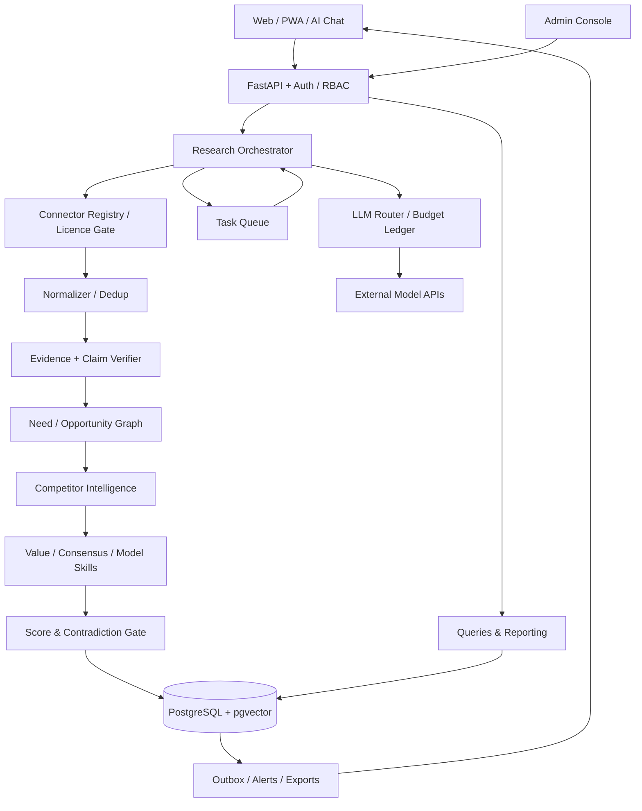

# 技术架构、数据模型与 API 契约（实施蓝图）

> 架构版本：0.1｜目标：AI Coding Agent 可分模块实现，核心模块可测试、可迁移、可回滚。不是已上线设计；具体依赖版本应在实际初始化时锁定稳定版并通过 CI 验证。

## 1. 总体技术原则

1. **模块化单体先行**：一套 API + 一个后台任务进程，不为「多 Agent」盲目拆微服务；未来通过事件/outbox 拆分。
2. **双数据边界**：`public` 情报与 `tenant_private` 研究分离；私有数据绝不进入公共 embedding/模型 cache。
3. **模型可换，判断不随模型换**：模型输出要过 Pydantic/JSON Schema、SourceVerifier、MethodologyVersion，不能把 LLM 原文直接写成已验证结论。
4. **采集遵守许可**：所有来源由 ConnectorRegistry 验证许可，处理撤销/删除；GummySearch 因 Reddit 商业 API 问题而关停，提示该风险是结构性的。
5. **研究可回放**：来源、提示词哈希、模型版本、Skill 版本、证据集合、评分版本与成本可复查。
6. **付费推断分层**：财务数据未知仍能生成待验证研究计划，`unknown` 不是错误。

## 2. 建议技术栈（不绑定品牌）

| 层 | 首选 | 原因与替代 |
|---|---|---|
| 前端 | Next.js + React + TypeScript + Tailwind CSS | 中文/英文、多端、SSR；可换其他 React 框架 |
| 后端 | Python FastAPI + Pydantic v2 + SQLAlchemy + Alembic | 文本分析与 AI 生态，强输入约束；可用其他标准 HTTP 框架替代 |
| 主数据库 | PostgreSQL 16+，启用 pgvector（可选） | 事务、JSONB、RLS，图关系先用边表即可 |
| 队列/任务 | Redis + Dramatiq/Celery（二选一，推荐 Dramatiq） | 幂等重试、周期调度、死信；长流程可迭代为 Temporal |
| 对象存储 | S3 兼容（本地 MinIO，云端任何兼容服务） | 源文档、研究快照、导出文件；按租户前缀与权限控制 |
| 全文检索 | PostgreSQL FTS 初期；量大时 OpenSearch | 避免初期维护过多服务 |
| 向量召回 | pgvector，查询必须带 `tenant_id`/可见性条件 | 先精确权限过滤，再语义召回 |
| AI 模型 | ProviderAdapter（OpenAI/Anthropic/其他兼容 API） | 模型路由、费用预算、结构化输出、超时、重试 |
| 认证 | OIDC/OAuth2 + httpOnly session；本地最小邮箱验证 | 可配置供应商，服务端鉴权与 RLS 双重防线 |
| 观测 | OpenTelemetry + JSON logs + Prometheus/Grafana 可选 | 任务 ID、source ID、证据链、成本与错误跟踪 |
| 部署 | Docker Compose(dev) / OCI 容器＋托管 Postgres(prod) | 可迁移，先不引入 Kubernetes |

**注意**：任何发布版本要锁定依赖与容器镜像，显式生成 `lockfile`，禁用浮动 latest tag。

## 3. 核心模块边界



- `Connector`: 只获取经许可的数据，不负责任何结论。
- `Normalizer`: 语言、日期/货币/URL标准化；保留原文与时间。
- `Evidence`: 从文档抽取 claim、支持/反对，来源独立性与类型；不作创业建议。
- `NeedGraph`: 需求身份归一和实体链接，负责合并/拆分、审计与市场视角。
- `MarketIntel`: 竞品与替代方案、价格事件；商业推断有证据来源。
- `Methodology`: 所有商业判断使用版本化 Skill schema。
- `ScoreEngine`: 规则化评分、不可覆盖的红线、缺失值约束。
- `Research`: 固定研究快照、对话约束、可生成后续验证任务。
- `Venture`: 私有孵化项目、实验与关卡。
- `Notification`: 变更事件聚合与去重；只对授权渠道发送。
- `Cost`: 预算预留、记账、退款/失败回退、防超额。

## 4. 完整任务生命周期

```text
scheduled | requested
   -> queued -> licence_checked -> collecting -> normalized
   -> deduplicated -> need_extracted -> need_resolved
   -> competitor_discovery -> evidence_verified -> counter_review
   -> method_scored -> quality_gated -> report_ready
   -> published_to_appropriate_scope -> monitor_registered
```

终态 `completed / paused_budget / blocked_licence / insufficient_evidence / failed_retryable / failed_permanent / canceled`。这些状态不是互斥的研究结论：例如 `research=completed` 与 `payment=unverified` 可以同时存在。

规则：
- 每个阶段持久化输入 `object_version` 与输出 ID；重试无需重复前置任务。
- `idempotency_key = tenant_id + task_type + normalized_query_hash + market + period + method_version`。
- 执行失败时确保事务写入事件表（Transactional Outbox），由异步消费者触发通知/重评。
- 每个外部请求限制并发、预算和期限；外部模型返回不能直接决定 publish，必须通过 verifier。
- 研究任务可暂停、续跑、取消；取消前已产生的外部费用仍记录。

## 5. 逻辑数据模型（表与唯一键）

### 5.1 账号与权限

`users(id, email, locale, timezone, created_at)`；`tenants(id, name, status)`；`memberships(tenant_id,user_id,role)`；`workspaces(id,tenant_id,owner_id,visibility)`；`api_approvals(id,tenant_id,action_scope,limits,expires_at,approved_by)`；`audit_logs(id,actor,action,resource_type,resource_id,tenant_id,at,old_hash,new_hash)`。

`visibility`: `public_research`（平台发布的公共结论） / `tenant_private` / `team_shared`；私有上传和导出永不默认公开。所谓“公共研究”也应归平台独立租户或显式公共投影，禁止从用户私有对象反向生成公共内容。

### 5.2 采集与许可

`source_registry(id, platform, region, type, license_basis, terms_url, terms_checked_at, allowed_actions_json, retention_days, expiry_at, state, rate_policy_json, cost_policy_json)`。

`source_credentials(id, source_id, tenant_id, encrypted_secret_ref, expires_at)`；不保存明文 token。

`collection_runs(id, source_id, started_at, finished_at, cursor_before, cursor_after, job_id, status, bytes_in, cost, errors_json)`。

`raw_signals(id, source_id, source_item_id, normalized_url, content_hash, published_at, ingested_at, lang, market, permitted_text_ref, scope, tenant_id, allowed_use_json, deletion_state)`，唯一键 `(source_id, source_item_id)`。

### 5.3 证据与主张

`evidence_clusters(id, independent_origin_key, canonical_signal_id, duplicate_count, provenance_json)`。

`claims(id, statement, claim_type, market_id, observed_at, reliability_status, needs_review)`，类型 `fact / inference / hypothesis / unknown`。

`claim_evidence(id, claim_id, signal_id, cluster_id, relation, strength, independence_weight, rationale, verifier_version)`，关系 `supports/refutes/context_only`；一条声明可有多个相反证据。

`evidence_reviews(id, cluster_id, reviewer_id, decision, rationale, reviewed_at)`；`source_takedown_events(id, source_id, content_key, action, effective_at)`。

### 5.4 需求与市场

`markets(id, country, region, language, currency, legal_profile_ref, updated_at)`；`personas(id, scope, tenant_id, attributes_json, jobs_json)`；`scenarios(id, trigger, context, cadence, constraints_json)`；`needs(id, canonical_label, core_job, outcome, pain_intensity, scope, tenant_id, status, merged_into_id)`。

`need_scenarios(need_id, scenario_id, persona_id, market_id, validity_status)`；`need_evidence(need_id, claim_id)`；`graph_edges(id, from_type, from_id, edge_type, to_type, to_id, market_id, provenance_json)`。

`opportunities(id, need_id, market_id, title, value_proposition, target_persona_id, recommended_category, scope, tenant_id, current_report_version, updated_at)`。

`opportunity_versions(id, opportunity_id, version_number, before_hash, after_hash, diff_json, created_by, created_at)`。

### 5.5 竞争、付费、评分、报告

`competitors(id, name, canonical_domain, legal_entity, market_scope)`；`competitor_offers(id, competitor_id, plan_name, value_proposition, price_value, price_currency, price_interval, collected_at, source_id, confidence)`；`competitive_relations(id, opportunity_id, competitor_id, relation, evidence_ref, last_checked_at)`。

`payment_assessments(id, opportunity_id, payer_persona_id, level, direct_payment_verified, proxy_metrics_json, wtp_range_json, unknowns_json, version)`；`pricing_experiments(id, venture_project_id, hypothesis, status, outcome_json, outcome_ref)`。

`scoring_models(id, semver, weights_json, criteria_json, gates_json, status)`；`score_snapshots(id, opportunity_id, version_id, potential_score, potential_interval_json, coverage_ratio, evidence_confidence, readiness_level, entry_score, execution_difficulty, personal_fit, verdict, rationale_json, scored_at)`。

`research_reports(id, opportunity_id, scope, tenant_id, version, as_of, evidence_cutoff, scoring_model_id, method_version, content_md_ref, references_json, published_at)`。

### 5.6 孵化、任务与运营

`venture_projects(id, tenant_id, opportunity_id, owner_id, status, started_at)`；`project_stages(id, project_id, stage, approved_by, decision, evidence_json, status)`；`experiments(id, project_id, hypothesis, metric, threshold, approved_scope_json, cost_limit, status, result_json, result_source)`。

`jobs(id, tenant_id, type, idempotency_key, state, priority, attempts, max_attempts, state_json, started_at, finished_at)`；`job_events(id, job_id, from_state, to_state, at, message)`。

`provider_models(id, vendor, model_slug, capabilities_json, cost_rules_json)`；`skills(id, skill_id, semver, prompt_hash, config_json, input_schema_json, output_schema_json, active)`；`agent_runs(id, job_id, model_id, skill_id, input_digest, output_digest, evidence_ids_json, tokens_in, tokens_out, cost, duration_ms, status)`。

`budget_accounts(id, parent_account_id, owner_scope, owner_id, currency, hard_limit, soft_limit, reset_policy)`；`cost_ledger(id, budget_account_id, agent_run_id, provider, amount, currency, event_type, occurred_at)`，`event_type = reserve/settle/release/refund`。

`watch_rules(id, tenant_id, target_type, target_id, rule_json, channels_json, active)`；`alerts(id, tenant_id, event_key, severity, evidence_ref, dedupe_window, status)`；`outbox_events(id, aggregate_type, aggregate_id, event_name, payload, state, created_at)`。

### 5.7 最关键的数据约束

- `scope=tenant_private` 强制 `tenant_id NOT NULL`；任何查询/缓存/索引必须绑定租户边界。
- 删除源后，保留可审计的“删除事件”，但不保留已无许可的正文/embedding；引用标记为 unavailable。
- `score_snapshots` 只能追加，不允许 UPDATE 历史分；最新分由版本引用决定。
- `payment_assessments.wtp_range_json` 在无依据时必须 null；费用与支付数据必须存币种、时间、市场与是否税前。
- 模型推断不允许写入 `claims.claim_type=fact`，除非经过 source verifier 且有人工/规则批准标准。
- 软删除/归档外，批量私有数据删除应覆盖对象存储、缓存、搜索索引和异步副本。

## 6. API 契约（建议 REST v1 + SSE 事件）

### 6.1 通用协议

- Base: `/api/v1`；所有日期 ISO 8601 UTC，前端按用户时区展示。
- Auth: Cookie session / Bearer token；API 层验证 scope + tenant_id；禁止仅依赖前端隐藏按钮。
- 所有 POST 可提供 `Idempotency-Key`；长任务返回 `202 Accepted` + job_id。
- 列表用游标分页 `next_cursor`；分页带租户过滤、字段选择；错误为 RFC 7807 `application/problem+json`。
- 所有研究输出携带 `as_of`, `source_coverage`, `methodology_version`, `scoring_version`；不默认「实时」。
- `/api/v1/jobs/{id}/events` SSE；长时间后台研究不堵塞 HTTP 请求。

### 6.2 核心端点

| 方法 | 路径 | 权限 | 行为 |
|---|---|---|---|
| GET | `/opportunities` | 登录/公共 | 查询市场/行业/成熟度/等级/可信度；只返回可见 scope |
| GET | `/opportunities/{id}` | 可见性授权 | 详情、来源、当前研究快照 |
| POST | `/research-tasks` | 用户 | 指定行业、人群、产品或模糊 idea，返回 job_id |
| GET | `/jobs/{id}` | 所有者/管理员 | 阶段、进度、成本、可恢复状态 |
| POST | `/jobs/{id}/cancel` | 所有者/管理员 | 幂等取消，不撤销已发生费用 |
| GET | `/opportunities/{id}/evidence` | 可见性授权 | 支持/反证、来源与可信度 |
| GET | `/opportunities/{id}/competitors` | 可见性授权 | 竞争地图（直竞、间竞、替代） |
| POST | `/opportunities/{id}/deep-research` | 用户/预算核验 | 创建深度研究任务 |
| GET | `/opportunities/{id}/scores` | 可见性授权 | 评分历史，事实与假设分离 |
| POST | `/opportunities/{id}/watch` | 用户 | 收藏、监控规则 |
| POST | `/venture-projects` | 用户 | 从机会创建私有项目 |
| GET | `/venture-projects/{id}` | 租户授权 | 阶段、假设、实验、进度 |
| POST | `/venture-projects/{id}/experiments` | 项目权限 | 创建待审批实验（不执行） |
| POST | `/experiments/{id}/approve` | 审批人 | 具体范围/预算/受众审批 |
| POST | `/chat/sessions` | 用户 | 在授权研究上下文创建会话 |
| POST | `/chat/sessions/{id}/messages` | 用户 | 结构化工具调用、引用 |
| POST | `/reports/{id}/exports` | 有权限/配额 | 生成 md/pdf/docx/pptx 异步任务 |
| GET | `/alerts` | 用户 | 个人预警列表、来源与影响 |
| GET | `/admin/sources` | 管理员 | 许可、健康、覆盖、费用 |
| PATCH | `/admin/sources/{id}` | 管理员 | 调整许可状态、采集策略 |
| POST | `/admin/methodologies/{id}/activate` | 超管 | 发布前执行评估集与审核 |
| GET | `/admin/usage` | 账单权限 | 成本、预算和模型/源分摊 |

### 6.3 示例：主动挖掘

```http
POST /api/v1/research-tasks
Idempotency-Key: req-example-001
Content-Type: application/json
```

```json
{
  "query": "针对美国和日本的居家养老场景，找出小团队可验证的未满足需求",
  "markets": ["US", "JP"],
  "persona": "solo_founder",
  "constraints": {"budget_currency":"CNY", "budget_max": 200000},
  "research_depth": "screening",
  "visibility": "tenant_private"
}
```

```json
{
  "job_id": "job_demo_001",
  "status": "queued",
  "links": {"self":"/api/v1/jobs/job_demo_001"},
  "budget_reservation_status": "reserved",
  "message": "已入队，尚未生成任何研究结论"
}
```

### 6.4 示例：Opportunity 响应中的认知边界

```json
{
  "opportunity_id": "opp_demo_001",
  "market": "JP",
  "as_of": "2026-11-08T00:00:00Z",
  "title": "居家照护沟通效率（示例）",
  "status": "needs_validation",
  "potential_score": null,
  "potential_interval": [60, 88],
  "score_coverage_ratio": 0.72,
  "evidence_confidence": "low",
  "payment_level": "L1",
  "direct_payment_verified": false,
  "readiness": "R2",
  "market_entry_verdict": "validate_first",
  "known_facts": ["存在可追溯的公开求助信号（仅示意）"],
  "inferences": ["可能存在重复沟通成本（尚未测量）"],
  "unknowns": ["支付主体", "本地合规", "替代方案的实际使用率"],
  "citations": [],
  "disclaimer": "虚构样例，不能作为实际商业情报"
}
```

## 7. 安全与授权

### 7.1 外部行动政策

| 行为 | 默认 |
|---|---|
| 合规的公开信源检索、分析、内部报告 | 允许（预算内） |
| 使用用户本人授权的私有文档作研究 | 允许（限该工作区） |
| 使用需付费 API | 仅当管理员已授权数据源且预算预留成功 |
| 发送调查、私信、联络第三方 | 禁止，要求单次明确授权 |
| 创建/付款订单、广告投放 | 禁止，要求金额/对象/渠道明确授权 |
| 对外发布用户私有研究 | 禁止，独立确认与预览 |
| 训练模型或扩展公共数据库 | 默认禁止使用用户私有材料 |

### 7.2 RLS 与隐私

数据库同时开启 Postgres RLS 和服务端 tenant_id 参数验证；后台管理访问需角色审计；用户自己删除项目后，派生摘要/向量缓存同批删除。模型请求可能进入供应商系统，用户界面应清楚说明所选供应商的数据处理机制，不在未获准时发敏感原文。

## 8. 部署与工程标准

**本地** `docker compose up` 即可启动 Postgres/Redis/MinIO/API/worker/web，提供 seed data；mock connector 默认不访问外网。生产把 Postgres、对象存储与队列接到云端托管服务，禁止向公众暴露数据库和管理 API。

建议单仓 monorepo：

```text
apps/web/                 # Next.js 前台、后台
apps/api/                 # FastAPI、认证、业务路由
apps/worker/              # 采集/研究/重评/导出任务
packages/contracts/       # JSON Schema / OpenAPI 导出
packages/methodology/     # Skill 版本、权重及测试样例
connectors/               # 接口实现、许可声明与测试桩
infra/                    # Docker Compose, IaC, env.example
migrations/               # SQLAlchemy Alembic migrations
specs/                    # 评估集与端到端测试
.github/workflows/        # Lint、Typecheck、Unit、Integration、Security
AGENTS.md                 # Coding Agent 工作契约
```

CI 必过：Black/Ruff + mypy（Python）、eslint/tsc（TS）、pytest、Playwright 关键旅程、migration smoke test、秘密扫描、依赖漏洞检查、租户隔离安全测试、schema 契约测试、成本熔断测试。

### 8.1 发布/回滚

- 每次数据库迁移必须提供 rollback（无法无损回滚的迁移提前 ADR 与备份）。
- 启用新的 connector 先 staging + 许可核实，再灰度；若授权撤销，可一键禁用并清理。
- 新评分/Skill 运行旧样本金标准对照，禁止自动改写过去已发布报告。
- 评分修改通过版本引用生效，相关历史机会需要排队重评，不直接重写。

## 9. 成本模型（暂不报价，参数化估算）

`monthly_cost = hosting + storage + ingestion_requests × unit_ingest_cost + bytes_stored × storage_price + model_tokens_in/out × actual_price + embedding + external_data_licenses + egress + monitoring + export_jobs`。

建立三种运行场景（参数待供应商报价核实）：

| 档位 | 可用许可源 | 每日原始信号 | 每日深度研究 | 预算管理 |
|---|---:|---:|---:|---|
| Lite（建议个人内测） | 3–5 | 200–1,000 | 0–3 | 固定硬上限，先低成本初筛 |
| Standard（封闭内测） | 5–12 | 1,000–8,000 | 3–10 | 任务优先级 + 源和模型分摊 |
| Research（扩展） | 按许可 | 8,000+ | 按价值 | 需专门数据合同和容量规划 |

**这些是负载假设，不是保证能抓取的数据量，也不是成本报价。** 先用账本记录实际每 1000 条原始信号和每份高质量研究的边际成本，再按可获得的源授权、模型价目表填入人民币成本范围。

## 10. 数据流审计与事故响应

每个发布的机会至少能回答：
1. **它来自哪里**（source_id/link/时间/许可）？
2. **它为什么被认为是真实需求**（need_id/claim/evidence_cluster）？
3. **谁会付钱**（payer path/支付等级/未知）？
4. **有什么竞争者**（竞品覆盖与时效）？
5. **为什么是这个评级**（评分版本/子项/证据覆盖/反证）？
6. **下一个实验是什么**（hypothesis/预算/批准/指标）？
7. **它是否已经过期**（数据截止日期/最后复核）？

若任何问题无法回答，前端必须明确缺失，不得展示伪完整性。
