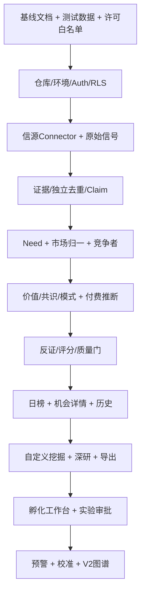

# AI Coding Agent 分阶段开发路线图与验收测试

> 计划版本：1.0｜按阶段/验收门推进，无固定截止日期。\
> 核心原则：每一个阶段必须可以运行、测试、演示、回滚。**不得将「写完代码」当作「功能已实现」**。

## 1. 开发顺序与依赖（关键路径）



开发任务必须按上游契约冻结后再向下推进。模型和 Skill 的结构化输出先写 JSON Schema、golden samples 再接模型。`docs/ADR-xxxx.md` 记录有意变更。

## 2. 基线里程碑（B0–B7）

### B0：工程基线 + 假数据演示（P0）

- B0-01 初始化 monorepo、CI、Docker Compose、.env.example、AGENTS.md；端口与服务健康检查。
- B0-02 数据库初始迁移：用户、租户、来源、Signal、Claim、Need、Opportunity、Job、Cost 记录。
- B0-03 权限与隐私：租户 RLS、公共 vs 私有空间、用户登录和审计。
- B0-04 Schema 契约：Signal, Evidence, Opportunity, PaymentAssessment, Score, Job, Report。
- B0-05 固定 mock 数据集：高热度无付款、低热度高替代支出、竞争高度饱和、违法限制、跨市场差异、错误转载。
- B0-06 每次 PR 自动执行 lint/types/schema/migration/permission 和至少 10 项单元测试。

**进入下一阶段的门**：新开发者（或 Coding Agent）在空环境中可按 README 安装启动，至少 2 个测试用户互不能见私有数据；所有演示数据标 `sample=true`。

### B1：授权来源采集和证据可信度（P0）

- B1-01 Connector SDK：输入 source config，返回标准 `SignalEnvelope`；实现健康检查、限流、重试、cursor。
- B1-02 接入至少 3 种合法方式：RSS/公共官方 API/用户手动上传（具体提供商经许可核实）。
- B1-03 Source Registry + 合规闸门：`approved/pending/blocked/expired`；未批准来源不能定时采集。
- B1-04 原始信号标准化：国家/语言/时间/URL、原文/译文/重要元信息分离。
- B1-05 三层去重：相同原始 ID、近重复内容、同源转载簇；合并留痕、可恢复。
- B1-06 Evidence/Claim/Provenance 存储、引用点击/源删除后的引用失效处理。
- B1-07 每日调度：增量采集＋安全重试＋日志/费用/异常视图。

**验收示例**：给输入 100 条（其中复制/转载 30 条），系统能展示原始 100 条与独立证据簇数量；禁用某平台后，未发出任何后续请求；数据过期后不能称「今日」。

### B2：需求抽取和竞品底座（P0）

- B2-01 统一提取 `persona × scenario × job × pain/cost × current_workaround`，输出 schema-valid JSON。
- B2-02 需求聚合；不能误把同一目标群的不同场景强并；合并/拆分有审计和回滚。
- B2-03 市场本地化模型和中文/英文展示；原文不覆盖，币种不隐式换算。
- B2-04 直接竞品、间接竞品、替代方案；公开定价与数据时间；未知收入使用 null。
- B2-05 UI：机会库列表、详情、来源、竞品；可按国别/人群/场景筛选。
- B2-06 错误信息表：采集失败、竞争者不存在、未知字段，均可在 UI 明示。

**验收示例**：同一用户“不会使用挂号 App”和“不会使用视频会议”形成两个子场景并可共享上位需求；在日本、美国各有独立的当地竞品字段。

### B3：《真需求》评估引擎与日榜（P0：MVP 核心）

- B3-01 Skill SDK：解析、价值、KANO/感知、共识利益、模式和反证分析插件；强制入出参校验。
- B3-02 支付者图谱、付款等级 L0–L5、代理证据、未知处理和下一步实验。
- B3-03 默认评分引擎、coverage/confidence 约束、角色适配、进入难度和独立评分历史。
- B3-04 红线/否决/冲突校验；关键事实无引用不得发布为「已验证」。
- B3-05 当下榜和未来观察轨；榜单数量按质量动态变化。
- B3-06 自动研究：可设置每天扫描，当没有高质机会时显示空榜而不造假。
- B3-07 高价值样本人工评审入口与评分解释，含历史变化。

**MVP 验收门（必须全部通过）**：
1. 连续 14 日运行任务，无超出合法许可的来源调用。
2. 无原始来源的「真实数字」断言计 0 容忍；引用失效可见。
3. 高痛点但无付款记录时，会进入待验证研究池，不被系统默认否决。
4. 同一个模型不同提示词轮次，关键事实不变；分数变化有原因和版本。
5. 价格、收入、竞品市场份额不允许 AI 编造。
6. 研究来源、权重、证据可信度与付费阶段分别可见。

### B4：指定挖掘、研究报告与对话（V1）

- B4-01 自然语言条件解析：领域、目标人群、场景、地区、竞品、预算、模糊想法。
- B4-02 深度研究任务排队/SSE 进度；前端不会因超时中断研究。
- B4-03 三角色研究模板与对话助手，所有事实引用 evidence ID。
- B4-04 报告 Markdown 快照，支持 PDF/Word/PPT 的独立导出器；多格式源/版本一致。
- B4-05 私有研究权限隔离与授权工具调用审批。
- B4-06 一份机会的不同角色/市场视角对比。

**验收**：从一句模糊想法生成事实/推测/未知分开的初稿，用户可查询证据。导出的报告带时间/版本/范围；不泄露另一个租户的客户研究。

### B5：动态竞争情报、雷达、提醒（V1）

- B5-01 竞品价格/功能/融资事件，支持变化比对与来源追溯。
- B5-02 Opportunity 触发增量重评；评分历史快照不覆盖。
- B5-03 趋势雷达，对观察/预测分别建模，不把预测当真相。
- B5-04 多条件关注/站内预警；邮件等通道可按授权加入；去重/静默/时区控制。
- B5-05 证据过期标志、来源撤销传播式删除。

**验收**：同一竞品变更被转载三次只触发一次用户预警；竞品降价的真实信息使评分重评，且结论包含可信来源。

### B6：孵化与实验审批（V1）

- B6-01 机会转私有 VentureProject；阶段、里程碑和 Go/Pivot/Stop 关卡。
- B6-02 需求访谈和付费验证计划生成，实验结果仅经用户提交/授权接口写入。
- B6-03 预算、对外行为、受访对象及审批权限；不自动替用户发送外部联系。
- B6-04 PRD/MVP 初版与验证数据关联；市场变化可提示复评，不自动修改正在开发的 MVP。

**验收**：没有实际支付，系统显示「待验证」；一个测试项目 Go / Pivot / Stop 均可决策并留下证据/原因/决策人。

### B7：校准与扩展（V2）

- B7-01 评估集历史回测，区分信息错误、模型错误、用户执行失败。
- B7-02 方法论/Skill版本发布、A/B/回滚、跨模型验证结果对比。
- B7-03 图谱关系高级 UI、跨市场迁移雷达、企业权限进阶、移动端 PWA→原生。
- B7-04 成本智能调度：VOI（信息价值）优先级、预算透明、质量成本曲线。

**验收**：旧报告不会因激活新模型改变；被证据推翻的机会按规则降级并保留之前的研究快照。

## 3. 实测前不得宣称「完成」的部件

| 部件 | 不算完成 | 算完成 |
|---|---|---|
| Connector | 能从网页抓到几条文字 | 有许可、稳定增量抓取、失败重试、过期和删除处理 |
| 需求抽取 | AI 写了段看似合理的文字 | 输出 schema 有效，能回到原证据，去重可审计 |
| 竞争研究 | 随便列出三家产品 | 官网真实、定位区分、替代方案完整、数据时间/未知可信 |
| 评分 | 生成百分制数字 | 子项可解释、覆盖阈值、反证/历史、评分版本齐全 |
| 报告 | 导出一份 PDF | 引用与页面一致、版本和时间一致、不含未经许可的原文 |
| 付费推断 | AI 猜一个价格 | 付费主体明确、证据级别明确、未知/验证下一步明确 |
| AI Agent | 能响应对话 | 不越权、不超预算、可停止、能复现引用、可回滚 |
| 日榜 | 固定发布 20 条 | 动态质量门、能不发布、重复机会持续更新而非新建 |

## 4. 分层测试矩阵（Gherkin 摘要）

### 质量与判断

```gherkin
Feature: 没有付费证据也不能错杀机会
  Given 一个目标用户频繁寻求解决方案且当前替代支出未知
  When 系统完成需求研究
  Then 付费意愿字段必须标 unknown 或 L0-L2
  And 系统可输出潜在价值、反证与最低成本验证任务
  And 不得发布“已证实客户愿意付款”的判断
```

```gherkin
Feature: 证据独立性
  Given 同一原始论坛帖子被 20 个网站转载
  When 系统计算需求证据可信度
  Then 应识别原始来源及 1 个独立证据簇
  And 不得以转载次数计为 20 个独立案例
```

```gherkin
Feature: 高潜力但证据不足
  Given 一项机会的潜力估算可达 90 分但证据覆盖率只有 50%
  When 系统完成评级
  Then 总体确认分为 null 且 readiness 不得自动设 R4
  And 系统应展示“待验证”与所缺证据
```

```gherkin
Feature: 竞品失实防护
  Given 官方来源没有披露竞争产品收入
  When 用户请求查看竞争格局
  Then 竞品收入必须为 unknown
  And 不能以模型推测的金额作为事实输出
```

### 隐私与权限

```gherkin
Feature: 私有研究隔离
  Given 用户甲已上传未公开的商业计划
  When 用户乙查看同一公共机会的详情或使用 AI 问答
  Then 不得检索、引用或看到用户甲的私有材料和派生向量
```

```gherkin
Feature: 外部行动审批
  Given 用户只说“帮我验证付费意愿”
  When AI 制定一个广告测试计划
  Then 只能创建 draft/awaiting_approval
  And 不得投放广告、付款或联系任何第三方
```

```gherkin
Feature: 预算硬上限
  Given 一项任务已达到硬预算上限
  When 后续研究准备调用收费模型
  Then 必须停止该付费调用并保存中间结果
  And 显示 paused_budget 状态
```

### 产品流程

```gherkin
Feature: 动态榜单
  Given 今天有 1000 条信号但没有一条达到证据质量门槛
  When 日榜发布
  Then 今日推荐可以为空
  And 应提供可查看的线索池和覆盖不足说明
```

```gherkin
Feature: 市场迁移
  Given 美国场景存在已证实支付证据
  When 系统建立中国市场机会视角
  Then 中国市场支付阶段不得直接继承美国市场 L4/L5
  And 应列出本地竞争与法规、购买决策的验证缺口
```

```gherkin
Feature: 方法论回滚
  Given Methodology 0.1 与 0.2 对同一机会打分不同
  When 管理员回滚到 0.1
  Then 历史 0.2 研究仍可访问
  And 新研究使用 0.1 的规则
  And 差异与操作记录完整
```

## 5. 人工评估流程（Golden Dataset）

每个样本使用 2 人独立标注，冲突由第三人仲裁；至少包含下列字段：

```yaml
case_id: GD-001
market: US
input_signals: [signal-1, signal-2]
expected_need:
  persona: "specific persona"
  scenario: "specific repeatable situation"
  job: "outcome desired"
claims:
  supported: []
  refuted: []
  unverifiable: []
expected_payment_level: L1
expected_decision: validate_first
must_not_assert:
  - "已证实愿意付款"
  - "市场规模为某个未经证实的数额"
```

跟踪：虚假来源率、关键信息误报、重复簇误判、误否决、信源失效、证据覆盖、报告时效、个人/地区偏差、模型成本。每次 Skill 版本升级必须跑完历史金标准集。

## 6. 每一个开发任务的定义（DoR / DoD）

**Ready（开始前）**：清楚任务描述、输入输出、所依赖契约、模拟样本、权限/预算边界、测试用例；如果缺失，Coding Agent 可提出 ADR，不得自行猜测影响架构的内容。

**Done（完成后）**：代码提交/PR、迁移与环境变量说明、单元测试、集成/E2E/安全边界测试、运行截图或日志、实际成功/失败路径、文档更新、未解决限制、可回滚说明。

每次迭代**一次只交一个小型垂直切片**：例如「采集 RSS→归一入库→证据可查」比「写完整个平台后台」更易验证。

## 7. 独立性检查：不能混在一起的评价维度

- 商业潜力高/证据可信低；需求真实/用户不付费；有人付费/企业不赚钱；企业赚钱/用户个人不适合做；现在不成熟/未来有潜力；竞争激烈/可从细分突破；社会有价值/无法商业化。

每一个场景都需要有 fixture 与相反案例，防止模型产生一刀切判断。

## 8. 实际发布前最低审查门

**个人测试**：技术安全与数据许可通过；样例可追溯；实际用户私有研究不泄露。

**封闭内测**：三类人群至少各有试用，自动化日常稳定、系统能够正确承认未知、能输出可执行验证计划；人工审核任务排队可控。

**公开上线**：完成渗透测试/第三方服务许可审查/灾备恢复演练/数据删除演练/计费与成本熔断/隐私政策；关闭所有测试身份和默认凭据。

## 9. 每阶段应留存的交付证据

- 可复现 Git commit SHA + issue/task ID。
- 通过的自动化测试与模型评估报告。
- 数据迁移和可回滚性证明。
- 当前开启的来源及许可状态清单。
- 成本账本摘要和本期异常。
- 用户可检查的演示路径；对于未覆盖能力，明确标为未开发。
